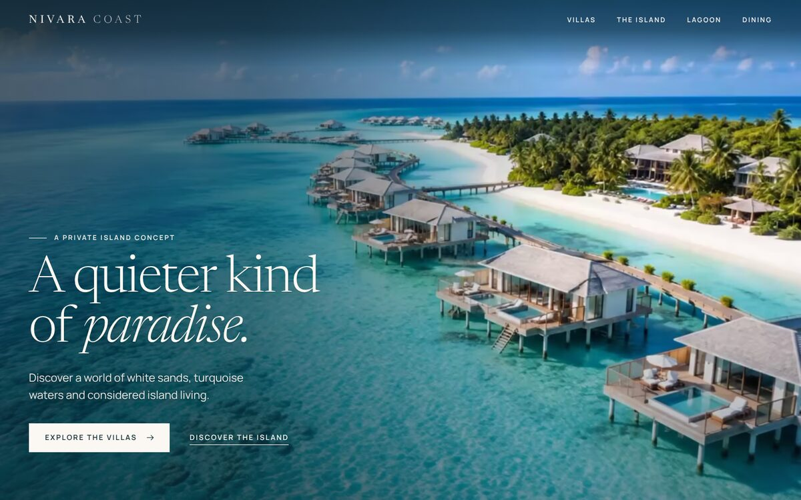

# Nivara Coast

The homepage for **NIVARA COAST**, a fictional private-island resort concept. It's built with plain HTML, CSS and one small JavaScript file. There's no framework and no build step, so it runs on any web host as-is.



## Preview it on your computer

1. Install [Node.js](https://nodejs.org) 18.17 or newer (20 or 22 recommended).
2. In this folder, run `npm install` once.
3. Run `npm start` and open <http://localhost:4173>.

Use `npm start` rather than double-clicking `site/index.html`. Some browsers limit fonts and video on pages opened straight from a folder.

## Put it online

Upload **the contents of the `site/` folder** to any static web host (Hostinger, Netlify, Cloudflare Pages, GitHub Pages and so on). Nothing else is needed on the server.

Once the site has a real domain, open `site/index.html` and find the comment marked `DEPLOY STEP`. Change `og:image` to a full URL and add `og:url` and `<link rel="canonical">` with the new address, so link previews on social apps show the right image. Most hosts compress files automatically; check yours does (gzip or brotli).

## What's in this folder

| Path | What it is |
| --- | --- |
| `site/` | **The website.** This is the folder you deploy. |
| `site/index.html` | The whole page: all text, links and image references. |
| `site/assets/css/main.css` | All styling. Colours, fonts and spacing are tokens at the top of the file. |
| `site/assets/js/main.js` | Header behaviour, phone menu, hero video, scroll reveals and the island map. The page still works without it. |
| `site/assets/img/` | Optimised photos in AVIF and WebP, in several widths, plus one JPEG fallback each. |
| `site/assets/video/` | The hero video, made in three sizes (wide, medium, phone) and two formats (AV1 and H.264). |
| `site/assets/fonts/` | Newsreader and Manrope, trimmed to the Latin characters (both under the SIL Open Font License). |
| `media/originals/` | Your untouched original photos and video. These are **not** deployed. |
| `scripts/` | Tools: `build-media.mjs` (rebuilds images and video), `build-fonts.py`, `serve.mjs` (preview server) and `screenshots.mjs` (review screenshots). |
| `tests/` | Automated browser checks. |

## Design decisions

- **Direction.** The aim is quiet luxury in an editorial style: generous space, large light serif headlines and restrained motion. All colours were sampled from the photography: ivory walls, sand, pale timber, lagoon turquoise and a deep-sea ink for text.
- **Type.** *Newsreader* is the display serif, used in light weights with italics for emphasis. *Manrope* is used for body text, labels and buttons.
- **Signature details.** A short horizon line sits before every section label. "The island at a glance" turns the original aerial photo into a guide, with six numbered points and a matching legend; pointing at a legend entry highlights its marker.
- **Hero.** The 8-second clip plays forward and then backward, so the loop has no visible jump. The audio is removed. The still image shown before the video starts is the clip's exact first frame, so the switch to motion can't be seen. On phones a portrait crop of the video keeps the villas above the headline and open water behind the words.
- **Villas.** Each villa type gets an outside view and an inside view:
  - *Overwater Villa*: the stone bath facing the sea, and the villas at the end of the boardwalk (a crop of the jetty photo). It is never described as having a pool.
  - *Overwater Pool Villa*: the villa with its plunge pool, and the bedroom that opens onto the pool deck.
  - *Beach Pool Villa*: the villa on the sand, and the bedroom looking over the garden, pool and beach.
- **Order of the page.** Hero, The idea, The Villas, The Island, The Lagoon, Dining, Arrival (the closing call to action), then the footer. "Explore the Villas" goes to the villas. "Discover the Island" goes to the island guide.
- **Honesty.** There are no prices, reviews, ratings, availability, address or contact details, and no structured data claiming a real hotel. The footer and the phone menu say the resort is a fictional concept.

## Changing things

- **Text.** Edit `site/index.html`. Keep sentences short and plain. Avoid long dashes; the site uses commas and full stops.
- **Colours, fonts, spacing.** Change the tokens at the top of `site/assets/css/main.css`.
- **A photo.** Replace the file in `media/originals/images/`, keeping the same name, then run `npm run media -- images`. The page picks it up with no HTML changes. If the new photo is composed differently, check the crops in `scripts/build-media.mjs` and the map marker positions in `index.html`.
- **The hero video.** Replace `media/originals/video/hero-aerial.mp4`, then run `npm run media -- video posters`. This needs [ffmpeg](https://ffmpeg.org) and takes a few minutes.

## Checks

```bash
npm run lint   # HTML validation
npm test       # browser tests on a desktop and a phone screen
npm run check  # both
```

The first time you run the tests on a new computer, run `npx playwright install chromium`.

The tests cover:
- the page loads with no errors and no failed files
- no sideways scrolling from 360px to 1920px wide
- every link reaches its section
- the hero buttons scroll to the villas and the island
- the phone menu keeps keyboard focus inside, closes with Esc and returns focus
- the skip link, focus outlines, link names and 44px touch targets on phones
- heading order, alt text and modern image formats
- each image file is large enough for the size it is shown at
- the video starts after loading, can be paused and is never downloaded when reduced motion is on
- the page is still complete when the video fails
- the right video file and format are chosen for each device (AV1 or H.264), and a paused video can still be resumed
- printing shows every section, and without JavaScript the navigation stays visible and readable
- touch tablets in landscape get full-size navigation targets
- text contrast over the photos, measured on the real rendered pixels: the hero and header at 15 screen and browser-window sizes and across the whole moving video, and the lagoon and arrival text at 12 sizes

**Results at handoff:** lint clean, all tests pass. Lighthouse (lab test on the local preview server):
- Mobile (simulated slow 4G): Performance 98, Accessibility 100, Best Practices 100, SEO 100. Largest Contentful Paint 2.3 s, Cumulative Layout Shift 0, Total Blocking Time 0 ms.
- Desktop: 100 in all four categories. Largest Contentful Paint 0.6 s, Cumulative Layout Shift 0.

## Limitations and what was not verified

- **Browsers.** The automated checks ran in Chromium only. Safari (iPhone, Mac) and Firefox were not tested on real devices. The site uses widely supported features, but check it on a real iPhone before launch.
- **H.264 video path.** The test browser cannot play H.264, so the AV1 path was the one tested. Browsers that support neither format, or that block autoplay (for example iPhone Low Power Mode), simply keep the still image. That is by design.
- **Performance numbers.** These are lab measurements from a local server without compression. Real numbers depend on the host and the visitor's connection.
- **Image resolution.** The supplied photos are about 1,500px wide, so full-width photos are slightly enlarged on very large or high-density screens.

## What a real business would still need

- A booking engine (link or embedded widget) or an enquiry form connected to a form service or backend. Right now the calls to action scroll to page sections.
- Real contact details and address. Only then add Hotel or LocalBusiness structured data.
- Privacy and cookie pages, plus a consent banner if analytics are added.
- The domain, social sharing tags (see "Put it online") and, if non-developers will edit the content, a CMS.
- Confirmed usage rights for all photography and video.
