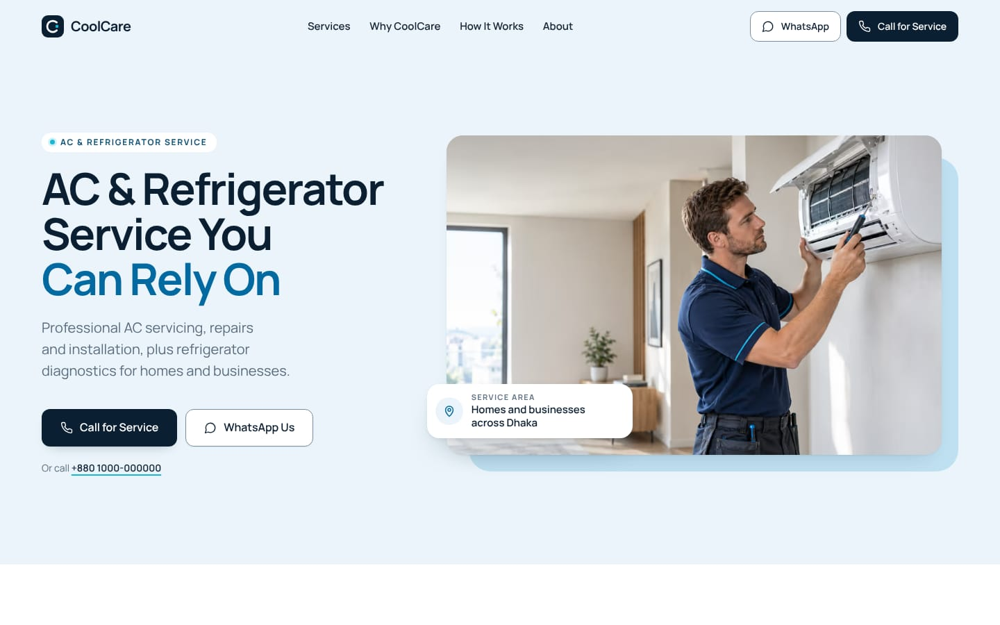
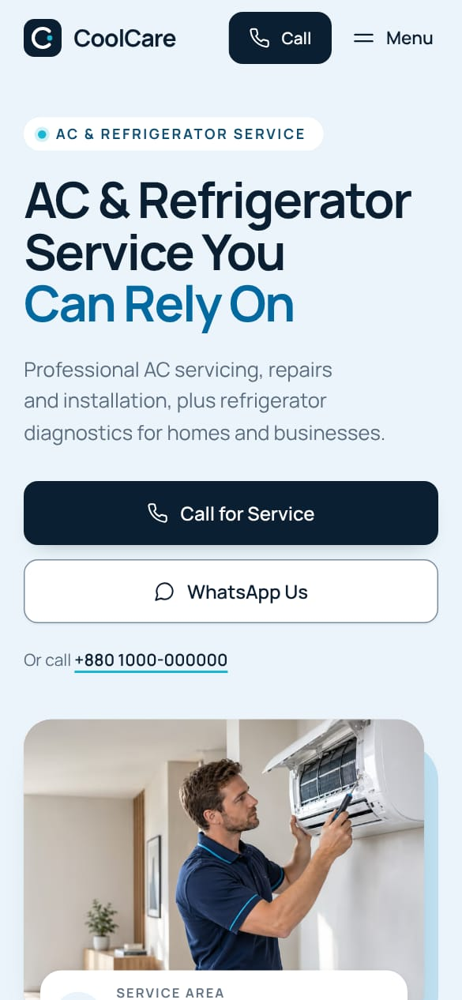

# CoolCare

The website for **CoolCare**, an AC and refrigerator service for homes and businesses, designed for a Bangladeshi local market (Dhaka by default). It is plain HTML, CSS and one small JavaScript file, built from small components, so it runs on any web host.

> CoolCare is a concept project. The phone number, WhatsApp number and service area are placeholders, and the footer says so until real details are set (see "Change the business details").





The whole page, top to bottom: [docs/preview-full-page.jpg](docs/preview-full-page.jpg).

## Preview it on your computer

1. Install [Node.js](https://nodejs.org) 18.17 or newer (20 or 22 recommended).
2. In this folder, run `npm install` once. (Inside the polliralo repository, `npm install` in the repository root is enough.)
3. Run `npm start` and open <http://localhost:4174>.

## Change the business details

Everything about the business lives in **one file, `site.config.mjs`**:

| Setting | What it is |
| --- | --- |
| `phone` | The number the Call buttons dial: `+`, country code and number, digits only (`+8801712345678`) |
| `phoneDisplay` | The same number as it is written on the page (`+880 1712-345678`) |
| `whatsapp` | The WhatsApp number: country code and number, digits only, no `+` (`8801712345678`) |
| `whatsappDisplay` | The WhatsApp number as written on the page |
| `serviceArea` | Where CoolCare works, as it reads in a sentence ("homes and businesses across **Dhaka**") |
| `siteUrl` | The live address once the site is online (`https://coolcare.com.bd/`). It turns on the link-preview image for social apps and the canonical address for search engines |
| `isConcept` | `true` while the details are placeholders. Set it to `false` once they are real: the footer note disappears and business details for search engines (structured data) are added |

Then run `npm run build`. Every Call button, every WhatsApp link (each with its own pre-written message), the About facts, the closing section, the footer and the page title update together. If a number is in the wrong format, the build stops and says exactly what to fix.

## Change the words

All text is in `src/content.mjs`, section by section. Edit it, then run `npm run build`. Keep sentences short and plain, avoid long dashes, and do not add claims that are not true (ratings, years in business, guarantees, same-day service); a test checks for these.

Do not edit `site/index.html` by hand: it is built from the components and gets overwritten. A test fails if it no longer matches its sources.

## Change a photo

Replace the file in `media/originals/`, keeping its name, then run `npm run media` followed by `npm run build`. The photos are made in AVIF, WebP and JPEG at several sizes, each with a tiny blurred preview. If a new photo is framed differently, check its crop in `scripts/images.config.mjs`.

## Put it online

1. If you know the address, set `siteUrl` in `site.config.mjs` and run `npm run build`.
2. Run `npm run zip`. It makes `dist/coolcare-site.zip` with `index.html` at the top and `assets/` beside it, which is the layout hosts expect.
3. Upload it: on Hostinger, open File Manager, go to `public_html`, upload the zip and choose Extract; on Netlify or Cloudflare Pages, drag the unzipped folder in. Nothing else is needed on the server. Most hosts compress files automatically; check yours does (gzip or brotli).

Run `npm run zip` again after any change, so the zip always matches the site.

## What's in this folder

| Path | What it is |
| --- | --- |
| `site/` | **The website.** This is the folder that gets deployed. |
| `site/index.html` | The built page. Made by `npm run build`; do not edit by hand. |
| `site/assets/css/main.css` | All styling. Colours, type sizes and spacing are tokens at the top. |
| `site/assets/js/main.js` | The phone menu, the header's scrolled state, the active section in the navigation, soft reveals and photo fades. The page works without it. |
| `site/assets/img/` | Optimised photos (made by `npm run media`). |
| `site/assets/fonts/` | Manrope, trimmed to Latin characters (SIL Open Font License). |
| `site.config.mjs` | **The business details.** |
| `src/content.mjs` | **All the words on the page.** |
| `src/components/` | The page's building blocks (see below). |
| `src/lib/` | Small helpers: safe HTML templates, contact links, responsive photos, icons. |
| `src/images.json` | Sizes of every photo, written by `npm run media`. |
| `media/originals/` | The untouched original photos. Not deployed. |
| `scripts/` | `build.mjs` (makes the page), `build-media.mjs` and `images.config.mjs` (photos and icons), `build-zip.mjs` (the upload zip), `build-fonts.py`, `serve.mjs` (preview server) and `screenshots.mjs` (review screenshots). |
| `tests/` | Automated browser checks. |
| `docs/` | `brand-guidelines.md` (colours, type, logo, frames, voice, photography) and the preview images above. |
| `dist/` | The upload zip. Not stored in Git; make it again any time. |

## How the page is built

The page is made of one component per part, in this order:

`Header` · `Hero` · `ServiceGrid` (four `ServiceCard`s) · `WhyCoolCare` · `Process` · `About` · `ContactCTA` · `Footer` · `Menu` (the phone menu)

Each component is a small JavaScript function in `src/components/` that turns the content and the business details into HTML. `npm run build` (no extra tools needed) assembles them into `site/index.html`, so the site that ships is plain, fast, static HTML that search engines read in full and that works without JavaScript. Data stays out of the components: words come from `src/content.mjs`, business details from `site.config.mjs`, photo sizes from `src/images.json`.

## Design decisions

- **Direction: Cool Blue Editorial.** A calm, light-blue page where premium comes from hierarchy, spacing, type, framed photography and proportion, not decoration: no gradients, blobs, glass effects, glows, icon rows, wave edges, counters or sliders. Full details are in `docs/brand-guidelines.md`.
- **Palette.** Sections alternate White and a soft Sky blue `#EAF4FA`, and the page has one dark moment: the Deep Navy `#0B1F33` contact panel. Deep Navy also carries headings, primary buttons and the logo. Ocean Blue `#0369A1` sets the accent words of each title ("done properly.") and the step numbers. Cool Cyan `#18B7D3` stays in small doses: the status dot in each label, underlines, the closing button on navy. Ice White `#F4F8FB` is the face of the service cards and the steps panel. Primary Text `#142334`; Secondary Text `#637487`, nudged to `#586A7D` on light blue where the original falls just short of 4.5 : 1; Border `#DFE7ED`.
- **Type.** Manrope only, weights 400 to 700. Headlines at 700 with tight tracking, each section title in two tones (navy, then the Ocean Blue accent words), small uppercase labels in pill tags, tabular figures for numbers.
- **Frames.** Every large photo sits in a frame: rounded corners, a soft shadow and a flat colour plate offset behind it (light blue in the hero and Why CoolCare, Deep Navy behind the About portrait). Each plate is offset in a different direction, and never over a caption.
- **First seconds.** Within the first screen a visitor reads what CoolCare does (the eyebrow and headline), which appliances (AC and refrigerator, named twice), and how to get in touch (Call for Service, WhatsApp Us, and the number written out for desktop visitors who cannot tap to call).
- **Hero.** A split layout on light blue: words on the left (about 42%), the wide photo of the technician at the indoor unit on the right, framed on a light-blue plate, with a small white card on its corner naming the service area. Desktops get the wide crop of the photo; phones and tablets get a closer 4:3 crop of the same photo below the words. The headline keeps the same three lines on every screen, sized to its column, with "Can Rely On" in Ocean Blue.
- **Header.** Logo, four section links, then WhatsApp and Call for Service. At the top of the page it shares the hero's light blue, so the first screen reads as one surface; once the page moves it turns white with a hairline. It stays at the top while scrolling and underlines the section being read. On phones: logo, a Call button and Menu.
- **Services.** Four photo-led cards on an asymmetric grid: wide and narrow on the first row, narrow and wide on the second, both photos in a row sharing one height. Each card is an Ice White mount holding its photo, with a number tag, one sentence in the customer's words and a round navy arrow that turns cyan on hover. The whole card is one link that opens WhatsApp with that service already written into the message ("Hello CoolCare, I need an AC installed."). The hero photo is not reused.
- **Why CoolCare.** A framed close-up of an airflow check, with a short caption below it, beside four principles on one white card, each with a small check: careful workmanship, clear diagnosis (including "No gas top-up without a leak check", the worry customers raise most often), professional service and respect for your space. The photo is cropped so the European church spire in its window stays out of the page.
- **How it works.** Three numbers in rings, joined by a dashed line, on one Ice White panel; on phones the line runs down the left with each number beside its words. No icons: the numbers carry the order.
- **About.** A short, honest brand statement (no founder story or history), a white facts card (service area, appliances, contact, each with a small line icon) and the technician portrait framed on a Deep Navy plate.
- **Contact.** The page's one dark moment: a rounded Deep Navy panel with "Need AC or refrigerator service?", one line of copy, Call for Service (the page's one cyan button) and WhatsApp Us, plus a card with the numbers and service area. On wide screens two faint rings, the logo's C drawn large, pass behind that card. There is no form, so nothing can pretend a request was sent.
- **Footer.** Light blue, like the hero: brand line, the four services, contact, the copyright line and the concept note.
- **Motion.** Buttons respond to hover and press, service cards lift a little as their photo zooms very slightly and their arrow turns cyan, links draw their underline, content eases up a little as it arrives, and the phone menu fades in. Everything appears at once with reduced motion switched on.
- **Mobile.** Designed separately, not shrunk: full-width stacked buttons on narrow phones, the call button always in the header, the menu's buttons at thumb height, compact steps, stacked facts, and both hero buttons on the first screen even on a 320 x 568 phone.
- **Reference designs.** The five reference sites gave the ideas that suit CoolCare: a split hero with a technician at work, light-blue sections, two-tone headlines, small pill labels, photos framed on offset colour blocks, a floating info card on the hero photo, round arrow buttons on service cards, white cards on light-blue grounds and a rounded navy closing panel. What made them look like templates was left out: wave edges, icon rows, slider dots, invented statistics and review stars, a search bar, orange accents and identical card rows.
- **Research.** Customers in Dhaka worry most about technicians who top up gas without finding the leak, who cannot explain the fault, and repeat visits that do not fix it. The copy answers those worries in plain words.

## About the photographs (please read)

The brief asked for authentic South Asian technicians in believable Bangladeshi homes. The eight supplied photos show a European-looking technician in European-style rooms. South Asian replacements could not be generated in this build, and the supplied photos were chosen for the site, so they are used as they are, with their alt text describing only what they show. For a real launch in Bangladesh, replace them with photos of CoolCare's own technicians (or South Asian replacements with the same framing): same file names in `media/originals/`, then `npm run media` and `npm run build`. The original framing of each photo is kept in `scripts/images.config.mjs`.

## Checks

```bash
npm run lint   # HTML validation
npm test       # browser tests on a desktop and a phone screen
npm run check  # both
```

The first time you run the tests on a new computer, run `npx playwright install chromium`.

The tests cover:
- the built page matches its components, words and business details
- no console errors or failed files; the brand font loads
- one h1 and no skipped heading levels; alt text on every photo; every photo loads and fades in
- the first screen names the service, the appliances and both ways to get in touch, and the call buttons stay on screen down to a 320 x 568 phone
- AVIF or WebP photos, and each photo file fits the size it is shown at (checked at 10 screen sizes and pixel densities)
- no long dashes or stock filler words; no invented claims (ratings, years, customer numbers, guarantees, same-day or emergency service, prices)
- every call and WhatsApp link uses the numbers in `site.config.mjs`, and each service card writes its own WhatsApp message
- no form and no "request sent" message anywhere
- no sideways scrolling from 320px to 1920px, and nothing pokes out of its column at 12 widths
- no words sit on top of a photo (the hero's service-area card overlaps the photo's corner, but its words sit on its own white ground); the headline keeps its three lines; service photos in a row share one height
- text contrast against its real background, for every piece of text on the page
- touch targets of at least 44px on phones and touch tablets; the header fits on one row at every width
- in-page links land each section just below the header; the navigation marks the section on screen; the header stays in reach while scrolling
- the whole service card is clickable, and keyboard focus outlines the whole card
- the phone menu keeps focus inside, closes with Esc and returns focus, and offers both ways to get in touch
- the skip link, names on every link and button, lists announced as lists
- reduced motion, printing and no JavaScript all show every section and photo

**Results at handoff:** lint clean and all 77 browser checks pass (a further 21 run only on the desktop or only on the phone setup, so each is skipped on the other). Lighthouse (lab test on the local preview server, without compression):
- Mobile (simulated slow 4G): Performance 100, Accessibility 100, Best Practices 100, SEO 100. Largest Contentful Paint 1.7 s, Cumulative Layout Shift 0, Total Blocking Time 0 ms.
- Desktop: 100 in all four categories. Largest Contentful Paint 0.4 s, Cumulative Layout Shift 0.
- The first visit downloads about 170 KB on Lighthouse's phone setup and 220 KB on its desktop setup, photos included.

## Limitations and what was not verified

- **Browsers.** The automated checks ran in Chromium only. Safari (iPhone, Mac) and Firefox were not tested on real devices. The page uses widely supported features (container query units, `:has()`, `<dialog>`, balanced text wrapping) and falls back gracefully where one is missing, but check it on a real iPhone before launch.
- **Photos.** See "About the photographs". They are also about 1,100 to 1,450 pixels wide, so the hero and the airflow photo look slightly soft on large high-density screens; 2,000px versions with the same framing would fix it. The photos stay in natural colour: the blue comes from the page, the frames and the technician's uniform, not from tinting the photos.
- **Placeholders.** The placeholder number dials nothing useful, and WhatsApp will say it cannot find it. That is expected until real numbers are set.
- **Not online yet.** The site has not been deployed, so `siteUrl` is empty and link previews have no image yet.
- **Language.** The site is in English. A Bangla version was not part of this build.
- **Performance numbers** are lab measurements from a local server without compression. Real numbers depend on the host and the visitor's connection.

## What a real business would still need

- Real phone, WhatsApp and service area in `site.config.mjs`, with `isConcept: false`.
- Photos of its own technicians at work in local homes.
- Opening hours, visit charges or prices, if it wants them shown. None were invented.
- A check that the name "CoolCare" is free to use locally (similar names appear in Dhaka listings).
- A domain, and a privacy page if analytics are added.
- Possibly a Bangla version of the page.

## Credits

Manrope by Mikhail Sharanda (SIL Open Font License). Phone, message and arrow icons adapted from Lucide (ISC License).
