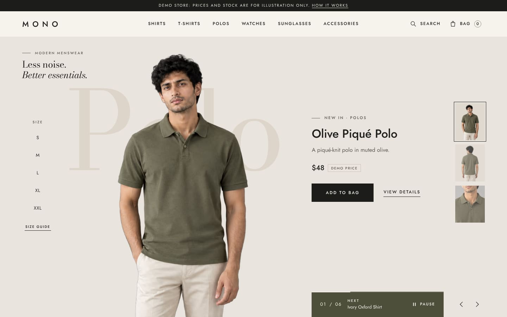

# MONO

**MONO** is a fictional premium menswear shop, built as a portfolio demo. It has 12 products (shirts, T-shirts, polos, watches, sunglasses and accessories) and every part of a real shop works: browsing, filters, search, product pages, a bag, a validated checkout with a demo payment, order confirmation and a store admin. All prices, stock and orders are demo data. No payment is ever taken and nothing ships.

More screens: [home on a phone](docs/screens/home-phone.jpg), [category page](docs/screens/collection-desktop.jpg), [product page](docs/screens/product-desktop.jpg), [checkout](docs/screens/checkout-desktop.jpg), [admin](docs/screens/admin-desktop.jpg).

The site is plain HTML, CSS and JavaScript (no framework). A small Node script turns the product data into a real HTML page for every address, which is good for search engines and fast to load. In the browser, a few JavaScript modules add the bag, checkout and admin, using the browser's own storage as the demo database.

## Preview it on your computer

1. Install [Node.js](https://nodejs.org) 18.17 or newer (20 or 22 recommended).
2. In the repository folder (one level above `shop/`), run `npm install` once.
3. Run `npm run shop:build`, then `npm run shop:start`, and open <http://localhost:4174>.

Use the preview server rather than opening the HTML files directly: the pages load the product data with `fetch`, which browsers block for files opened from a folder.

## What the shop does

| Area | What works |
| --- | --- |
| **Home** | A product slider hero in the style of the owner's references: each clothing piece stands on a warm canvas with a giant faint word behind it, sizes on the left, angle thumbnails on the right and a bar in the product's own colour. It moves on every 7 seconds with a visible Pause button; it stops for hover, keyboard focus, a hidden tab and reduced-motion settings. Swipe and arrow keys work. On phones the hero is a compact 320 to 350 px tall. Below it: shop by category, new arrivals, Shop the Look (two looks, each item addable), a watches spotlight on a dark ground, sunglasses and accessories, a short brand note and a demo newsletter. |
| **Collections** | Shop all and six category pages, each with its own heading, photo and count. Filters for size, colour, price and stock, five sort orders, removable filter chips, "Clear all", an empty state, and the choices kept in the address so a filtered page can be shared. Cards glide to their new places when the order changes. On phones the filters open in a drawer. |
| **Search** | Instant search from the header on every page, plus a full search page (`/search/?q=olive`). |
| **Product pages** | Angle thumbnails, a full-screen photo viewer, size choice with sold-out sizes marked, a size guide, colour links between the two polos, quantity, add to bag (it will not add clothing without a size), "Complete the look", "More in" this category, details and delivery information. On phones the photos swipe and an Add to bag bar stays at the bottom. A link such as `/products/olive-pique-polo/?size=l` opens with size L chosen. |
| **Bag** | A side drawer on every page and a full bag page: change quantity, remove with Undo, clear the bag, a free-delivery meter, and clear messages when an item has sold out or changed. |
| **Checkout** | One page: contact, delivery address (labels and postcode rules follow the chosen country), delivery method and payment. The payment choices are **Test card** (nothing is charged and no card details are asked for) and **Cash on delivery**. Every field is checked, with a summary of problems at the top. Placing the order saves it, lowers the stock and empties the bag. |
| **Order confirmation** | The order number, items, totals, address and next steps, clearly marked as a demo order. |
| **Admin** (`/admin/`) | A dashboard of the demo data, a product editor (add, edit, hide, delete; prices, words, sizes and stock, photos), a restock list, the list of demo orders with their status, a data download and "Reset demo data". Changes show up in the shop straight away. |
| **Content** | About (with "How this demo works"), Contact (a demo form), Size guide, Privacy, Shipping and returns, and a designed 404 page. |

## How the demo data works

The 12 products live in `src/data/catalog.json`. The build copies them, with the image list, into `site/assets/data/store.json`, which every page reads. Anything a visitor changes is kept only in **their own browser** (localStorage), so it survives a reload but nobody else sees it:

| Browser storage key | What it holds |
| --- | --- |
| `mono.cart.v1` | The bag |
| `mono.catalog.v1` | Admin changes to products, prices and stock (only used while the shipped catalogue is unchanged) |
| `mono.orders.v1` | Demo orders placed at checkout |
| `mono.checkout.draft.v1` (session only) | Checkout form values, so Back does not lose them |

To start again: "Reset this demo in my browser" on the About page (`/about/#demo`), or "Reset demo data" in the admin.

**This is not a real shop.** The admin has no sign-in, and anyone who opens `/admin/` can use it, but the changes only affect their own browser. A real store needs a server with sign-in and permissions, a database, server-side checks of prices and stock, and a payment provider. The shop's data layer (`site/assets/js/lib/store.js` and `cart.js`) is the one place that would change to talk to such a server.

## Put it online

The folder to publish is **`shop/site/`**. It needs no server code.

- **Cloudflare (recommended, already configured).** `shop/wrangler.jsonc` sets up a static Worker with the 404 page and trailing-slash handling. From the repository folder run `npx wrangler deploy --config shop/wrangler.jsonc` (the first time, `npx wrangler login` connects your Cloudflare account). You can also upload the contents of `shop/site/` in the Cloudflare dashboard. The `_headers` file adds caching and keeps the admin pages out of search engines.
- **Any static host.** Run `npm run shop:zip` and upload `dist/mono-shop-site.zip`. `index.html` sits at the top of the zip with `assets/` beside it. Tell the host to use `404.html` for unknown addresses.

**Before launch, set the address.** Open `shop/src/config.mjs` and put the live address in `LIVE_ADDRESS` (for example `https://mono.example.com`), or build once with `SITE_URL=https://mono.example.com npm run shop:build`. The build then writes full canonical and sharing addresses, a `sitemap.xml` and the sitemap line in `robots.txt`. Upload the site again after every build.

## Search engines (SEO)

The research behind these choices is in `docs/research/seo.md`.

- Every page has its own title and description (the build reports an error if two pages share one), a single main heading, a canonical address and sharing tags. Each product and category has its own share image (1200 x 630, made by `npm run shop:og`).
- Breadcrumbs on category and product pages, with matching structured data. The home page describes the site and the brand.
- The bag, checkout, search, admin and 404 pages are kept out of search results with `noindex`. They are not blocked in `robots.txt`, so search engines can read that instruction.
- Because the products and prices are fictional, `SEO_MODE` in `config.mjs` is `'demo'`: no product price markup is published (Google shows such prices without the "demo" label). The full product markup is built in and switches on with `SEO_MODE = 'live'`, which is only right for real products, prices and checkout.
- Photos are AVIF and WebP in four widths, with a fallback; only the first, largest image of a page loads early.

## Motion

Motion follows `docs/research/motion.md`: calm curves, transform and opacity only, nothing that blocks a click.

- Opening a product from a card grows its photo into the product page photo. This uses the browser's page-to-page transitions, in Chrome, Edge and Safari 18.2 and newer; other browsers simply load the page.
- Sections rise in as they come into view.
- The bag opens with the new item highlighted, and the bag count gives a small pulse.

With the operating system's "reduce motion" setting on, everything appears at once and the slider never moves by itself.

## Change the shop

| To change | Edit | Then run |
| --- | --- | --- |
| Products, prices, sizes, stock, descriptions, categories, looks | `src/data/catalog.json` | `npm run shop:build` |
| Delivery prices, the free-delivery threshold, payment choices | `site/assets/js/lib/pricing.js` | `npm run shop:build` |
| Size guide measurements (demo figures) | `src/data/size-guide.json` | `npm run shop:build` |
| Photos | Add the original to `media/originals/` and its entry to `scripts/media.mjs` | `npm run shop:media`, `npm run shop:og`, `npm run shop:build` |
| Page layout and words | `src/templates/pages/<page>.mjs`, `site/assets/css/pages/<page>.css` | `npm run shop:build` |
| Colours, fonts, spacing, buttons | The tokens at the top of `site/assets/css/base.css` | (no build needed) |

Never edit the files in `media/originals/`; they are the untouched originals. The clothing photos are cut out of their backgrounds (in `media/cutouts/`) so every product stands on the same canvas.

## Checks

`npm run shop:check` builds the site, validates every page's HTML and runs the browser tests at desktop size (1440 x 900) and on a phone (Pixel 7). The tests cover every page and the journeys between them, from first visit to placed order and the admin.

Lighthouse on a phone profile (October 2026, local build): performance 98 to 100, accessibility 97 to 100, best practices 100. SEO scores 92 until the live address is set (the canonical links are paths until then) and reaches the full score once it is.

## What's in this folder

| Path | What it is |
| --- | --- |
| `site/` | **The website.** This is the folder you publish. Most of it is made by the build. |
| `site/assets/css/base.css` | Design tokens and every shared component (header, footer, buttons, cards, drawers, forms, motion). |
| `site/assets/css/pages/` | Styles for each page. |
| `site/assets/js/app.js` | Runs on every page: header, menu, search, bag drawer, quick add. |
| `site/assets/js/lib/` | Shared modules: product data and demo database (`store.js`), bag (`cart.js`), prices (`pricing.js`), page builders used by both the build and the browser. |
| `site/assets/js/pages/` | Scripts for each page. |
| `src/data/` | Product catalogue, size guide and the image list. |
| `src/templates/` | The page frame (`layout.mjs`) and one template per page type. |
| `scripts/` | `build.mjs` (writes every page), `media.mjs` (optimises photos), `og.mjs` (share images), `serve.mjs` (preview server), `shots.mjs` (screenshots), `zip.mjs` (upload zip). |
| `tests/` | Browser tests. |
| `media/` | Original photos and cut-outs. Not published. |
| `docs/` | The owner's brief, design references and research notes. `docs/BUILD-SPEC.md` describes how the code fits together. |

## Limits

- Everything a visitor does stays in their browser: no accounts, no emails, no real orders, no shared stock.
- The admin is a demonstration of the screens, not a secure back office.
- Prices, stock, delivery rates and the size guide figures are demo data.
- Page-to-page photo transitions need a recent Chrome, Edge or Safari; elsewhere pages load normally.

## Credits

- Typefaces: [Bodoni Moda](https://fonts.google.com/specimen/Bodoni+Moda) and [Jost](https://fonts.google.com/specimen/Jost), both under the SIL Open Font License, served from this site.
- Photography: supplied by the owner for this demo. Clothing cut-outs made with [rembg](https://github.com/danielgatis/rembg).
